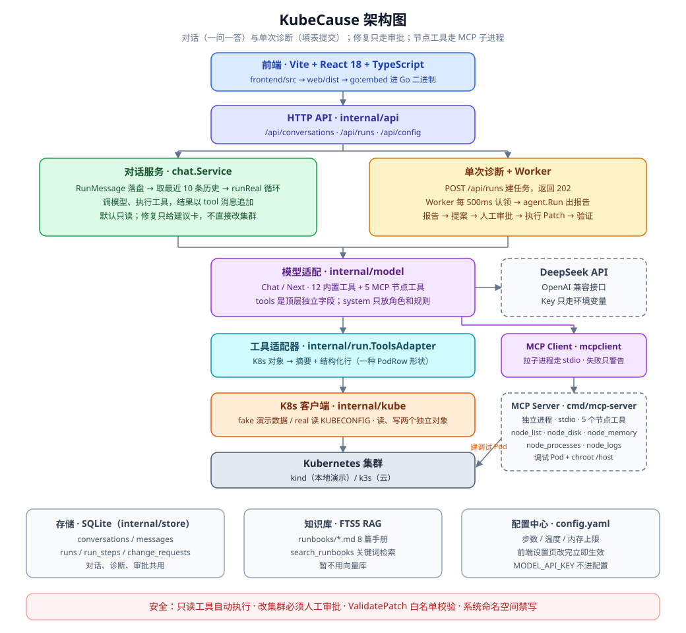

# KubeCause

**面向 Kubernetes 的 AI 故障诊断与受控运维 Agent**

KubeCause 通过自然语言交互，结合大模型工具调用、Kubernetes 实时状态和排障手册，帮助用户发现异常、分析证据、形成修复建议，并在**人工审批后**执行受限变更与验证。

> 当前版本：**v0.14.0** · 项目仍在开发中，主要用于本地演示和技术验证；请勿将默认演示配置直接用于生产环境。

[演示视频](#演示视频) · [快速开始](#快速开始) · [核心能力](#核心能力) · [系统架构](#系统架构) · [Roadmap](ROADMAP.md) · [Changelog](CHANGELOG.md)

## 演示视频

以下录屏展示 KubeCause 的对话式故障诊断、Agent 工具调用与结构化结果。演示用于展示交互流程，不代表可以将默认配置直接用于生产环境。

https://github.com/user-attachments/assets/270dff5f-017c-4b61-9ba7-34132ec58207

> 无法播放时，可[直接打开演示视频](https://github.com/user-attachments/assets/270dff5f-017c-4b61-9ba7-34132ec58207)。

## 核心能力

| 能力 | 当前实现 |
| --- | --- |
| **对话式诊断** | 自然语言提问、连续追问、近期消息上下文；默认保留最近 10 条用户与助手消息 |
| **Agent 工具调用** | 自动选择只读 Kubernetes 工具获取资源、事件和日志；支持单次模型响应包含多个工具调用（顺序执行） |
| **基础知识检索** | 使用 SQLite FTS5 和关键词回退机制检索 `runbooks/` 中的排障手册 |
| **MCP 节点诊断** | 通过独立 MCP Server 接入 5 个 Linux 节点诊断工具；真实集群模式下按配置启用 |
| **受控修复与创建** | 生成 Deployment Patch / 创建建议卡，经人工审批后校验、执行和验证 |
| **持久化任务** | SQLite 保存正式诊断、步骤、审批、执行状态；Worker 支持启动恢复 |
| **模型与配置** | Stub 演示和 OpenAI 兼容模型接口；运行参数支持配置文件及设置页调整 |
| **Web 界面** | React + TypeScript 对话页面、结构化结果卡片、执行时间线和审批交互 |

**当前范围：** 已有基础上下文、对话自动摘要和关键词 RAG，但尚无向量长期记忆、语义混合检索、SSE 流式回答或 Kubernetes 工具 MCP Server；这些属于后续规划。

## 工作流程

```text
自然语言提问
    ↓
Agent 根据上下文选择工具
    ↓
Kubernetes API / MCP 节点工具 / Runbook 检索
    ↓
证据与诊断结论 → 修复或创建建议
    ↓
用户创建正式任务 → 人工审批
    ↓
安全校验与 Dry-run → 执行变更 → 读回与 Rollout 验证
```

对话本身不会直接修改集群。需要写操作时，必须先形成提案并经过审批。也可以直接创建正式诊断任务，查看持久化的步骤和结果。

## 快速开始

### 无集群、无 API Key 的本地演示

**要求：Go 1.25+**（以 `go.mod` 为准）。默认使用 fake Kubernetes 客户端与 Stub 模型：

```bash
git clone https://github.com/rynvaro/kubecause.git
cd kubecause
make run
```

打开 [http://localhost:8080](http://localhost:8080)，可以尝试：

```text
当前集群状态怎么样？
demo 命名空间里有哪些异常 Pod？
demo-api 为什么一直重启？
```

此模式使用模拟集群数据和预设模型行为，**不代表真实模型的诊断效果**。仓库带有前端构建产物；若需要重建前端，执行 `make frontend`（需要 Node.js/npm）。

### 接入真实集群和模型

先确认 kubeconfig 指向**隔离的测试集群**，再设置模型 API Key：

```bash
export KUBECONFIG="$HOME/.kube/config"
export MODEL_API_KEY="你的模型 API Key"

KUBE_MODE=kubeconfig \
MODEL_MODE=real \
MODEL_BASE_URL=https://api.deepseek.com/v1 \
MODEL_NAME=deepseek-chat \
go run ./cmd/server
```

切换其他 OpenAI 兼容服务时，可调整模型地址、名称和 API Key；实际兼容性以服务商实现为准。

如需启用 MCP 节点工具，还需编译独立的 Server：

```bash
go build -o mcp-server ./cmd/mcp-server
```

主服务在真实集群模式下默认尝试从 `./mcp-server` 启动 MCP 子进程；连接失败会降级为普通诊断，不阻断主流程。详见 [MCP Client 接入](docs/mcp-client.md)。

完整的 kind 演示、环境变量与 API 调用见 [安装与演示指南](docs/getting-started.md)。

## 演示场景

| 场景 | 典型现象 | 排查方向 |
| --- | --- | --- |
| OOMKilled | Pod 反复重启 | 容器状态、资源限制、事件 |
| ImagePullBackOff | Pod 无法拉取镜像 | 镜像名称、Tag、拉取事件 |
| 探针失败 | 容器重启或服务未就绪 | 探针配置、事件、运行状态 |

仓库提供故障案例与离线评估用例。**Rollout 成功不等于业务故障彻底消除**，例如调大内存限制不一定解决程序内存泄漏。

## 系统架构



| 模块 | 职责 |
| --- | --- |
| React Web UI | 对话、结果卡片、时间线、审批 |
| Go API / Chat / Agent | 上下文、模型调用、工具调度、诊断 |
| Kubernetes client-go | 集群只读查询及受控写入 |
| MCP Client + Linux MCP Server | 发现并调用节点诊断工具 |
| SQLite + FTS5 | 任务与会话存储、关键词知识检索 |
| Worker / Repair | 任务恢复、审批后的执行与验证 |

当前采用单个 Go 服务运行 API 和 Worker，并通过独立的 MCP 子进程扩展节点工具；前端构建产物由 Go 服务提供。

## 安全边界

- **人工审批**：模型只能提出建议，未经批准的写操作不会自动执行。
- **受限写操作**：仅支持 Deployment 的指定 Patch 字段和受约束的 Deployment 创建；系统命名空间禁止写入。
- **执行保护**：执行前校验目标、字段、资源版本并尝试 Dry-run；执行后读回并验证 Rollout。
- **权限隔离**：支持为读写操作配置不同 kubeconfig，实际安全性仍取决于 Kubernetes RBAC。
- **尚无用户鉴权**：当前演示 API **未实现用户身份认证与审批权限控制**，不可直接暴露到公网并授予集群写权限。

详细约束见 [技术设计与安全约束](docs/technical-notes.md)。

## 开发与测试

```bash
make test      # Go 单元测试
make vet       # 静态检查
make build     # 构建检查
make eval      # Stub 模式离线评估
```

## 文档与计划

- [安装、配置与演示](docs/getting-started.md)
- [技术设计与安全约束](docs/technical-notes.md)
- [MCP Client 接入](docs/mcp-client.md) · [Linux 节点 MCP Server](docs/mcp-linux.md)
- [架构图](docs/architecture.svg)
- [Roadmap](ROADMAP.md) · [Changelog](CHANGELOG.md)

欢迎通过 GitHub Issues 反馈使用问题、故障案例与改进建议。
